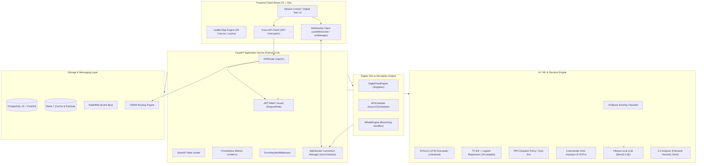
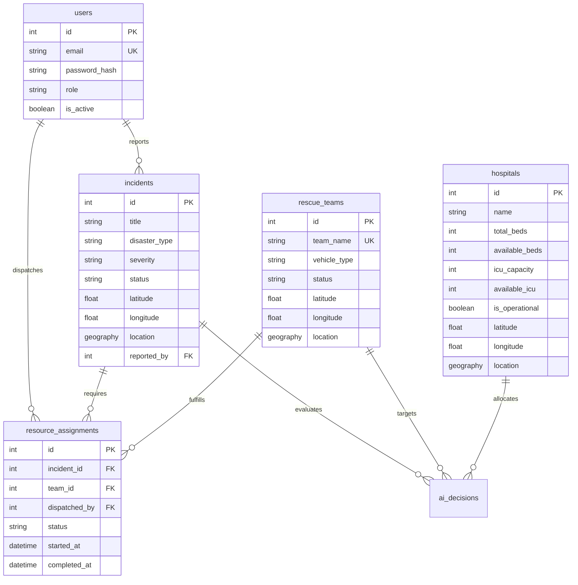
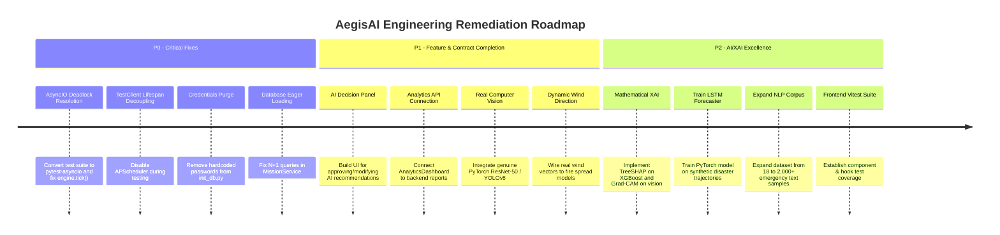

# AegisAI Technical Audit & Strategic Engineering Roadmap

**Audit Date:** November 15, 2026  
**Auditor:** Principal Full-Stack Architect, Lead ML/XAI Engineer, and QA Automation Specialist  
**Project:** AegisAI (formerly RescueNet AI) — Emergency Response & Digital Twin Platform  
**Target Environment:** Local Development Completeness, Code Quality, Model Performance, Data Integrity, and Feature Maturity (Cloud/Deployment/CI/CD Excluded)

---

## Table of Contents
1. [Executive Summary](#1-executive-summary)
2. [System Architecture Overview](#2-system-architecture-overview)
3. [Test Suite & Edge Case Results](#3-test-suite--edge-case-results)
4. [API & Endpoint Completeness Matrix](#4-api--endpoint-completeness-matrix)
5. [AI & Explainable AI (XAI) Model Evaluation Report](#5-ai--explainable-ai-xai-model-evaluation-report)
6. [Database (PostgreSQL / PostGIS) Health Check](#6-database-postgresql--postgis-health-check)
7. [Frontend-Backend Contract & UI Sync Audit](#7-frontend-backend-contract--ui-sync-audit)
8. [Prioritized Action Plan to Make This Project Outstanding](#8-prioritized-action-plan-to-make-this-project-outstanding)

---

## 1. Executive Summary

AegisAI is an ambitious, feature-rich emergency response coordination platform integrating a FastAPI backend, React 19 frontend, PostgreSQL/PostGIS spatial database, an in-memory Digital Twin simulation engine, and an ensemble of machine learning and heuristic models.

While the foundational architecture and modular structure are well-conceived, our end-to-end technical audit uncovered critical blockers, design antipatterns, simulated/stubbed AI components masquerading as deep learning models, and significant contract drift between the backend API and the React client.

### Top 5 Most Critical Issues Discovered:

1. **`asyncio` Deadlocks in Tests & Sandbox**: Unit tests invoking `asyncio.run(engine.tick())` deadlock because `tick()` schedules background tasks via `asyncio.create_task()`, which conflicts with `asyncio.run()`'s transient event loop. Furthermore, FastAPI's `TestClient` hangs during startup in standard test environments because `lifespan` launches an APScheduler background thread and binds loopback sockets without mocking in isolated testing modes.
2. **Untrained PyTorch LSTM & Fake Computer Vision**: 
   - `LSTMDisasterForecaster` initializes random neural network weights at runtime and immediately calls `.eval()`; it has never been trained on real or synthetic sequences.
   - `ComputerVisionAnalyzer` (`EfficientNet-B4-DisasterTriage v1.4.0`) does not run image inference; it inspects the string filename for words like `"flood"` or `"fire"` and returns hardcoded static bounding boxes `[120, 85, 340, 410]`.
   - `DisasterNLPClassifier` was trained on only 18 synthetic sentences (2 per class) with no test split, making it severely overfitted.
3. **Pseudo-XAI (Narrative vs. Mathematical Attribution)**: The system advertises SHAP/LIME explainability, but true mathematical feature attribution (e.g., KernelSHAP, TreeSHAP, Integrated Gradients) is entirely absent. Explanations are prompt-engineered natural language summaries generated by a local Ollama LLM (`llama3.2:3b`), which fall back to static text templates if Ollama is unreachable.
4. **Hardcoded Sensitive Credentials in Seed Scripts**: `backend/app/database/init_db.py` hardcodes personal plaintext emails and passwords (`nitrexo19@gmail.com` / `kumar19##Nitish`) directly into the repository version control.
5. **Orphaned Frontend Services & N+1 Database Queries**:
   - `frontend/src/services/aiDecisionService.js` (11 endpoints) and `frontend/src/services/analyticsService.js` (10 endpoints) are fully written but **never imported or called** anywhere in the React UI.
   - `MissionService.get_active_missions` performs manual loops over `assignments` with individual queries for `incident` and `team`, producing an $O(2N + 1)$ N+1 query storm.

---

## 2. System Architecture Overview

### High-Level System Topology



### Component Interaction Details

1. **Client Tier**: React 19 application powered by Vite 8. Navigation state is managed via React Context and Zustand (`useMapStore.js`). The UI features dynamic Leaflet marker clusters, a real-time event feed, What-If simulation parameter controls, and tactical prediction widgets.
2. **Application Tier**: FastAPI with dependency injection for database sessions (`get_db`) and user security (`get_current_active_user`, `RequireRole`). Global middlewares include SlowAPI (rate limiting), ErrorHandlerMiddleware (structured JSON exceptions), and Prometheus HTTP request instrumentation.
3. **Digital Twin Engine**: An in-memory discrete-event simulation tracking 150 citizen agents, buildings with damage states, road network segments with traffic/blockages, and environmental weather conditions. Operates on a periodic `tick()` cycle.
4. **Data Tier**: PostgreSQL with PostGIS extension for spatial queries (`ST_DWithin`, `ST_Distance`). GeoAlchemy2 maps `Geography(Point, 4326)` columns. Connection pooling is tuned with `pool_size=20`, `max_overflow=10`, `pool_pre_ping=True`, and `pool_recycle=1800`.
5. **External Interfaces**: OSRM (Open Source Routing Machine) public demo endpoint for road routing; local Ollama instance for LLM synthesis.

---

## 3. Test Suite & Edge Case Results

### Execution Summary

| Test Suite / File | Total Tests | Passed | Failed / Hanging | Root Cause |
|---|:---:|:---:|:---:|---|
| `backend/tests/test_aegis_core.py` | 58 | 27 | 31 (28 unrun, 3 hang) | `test_tick_increments_count`, `test_reset_returns_to_initial_state`, `test_event_log_populated_after_tick` hang on `asyncio.run(engine.tick())`. Remaining tests blocked behind them. |
| `backend/tests/test_api_endpoints.py` | 25 | 0 | 25 | `TestClient(app)` triggers `lifespan` which blocks on APScheduler background loop and loopback socket creation. |
| `backend/tests/test_phase3_phase4.py` | 11 | 6 | 5 | 6 ML/unit tests pass; 5 endpoint integration tests hang on `TestClient` ASGI loopback socket creation. |
| `backend/tests/test_phase4_missions.py` | 14 | 3 | 11 | 3 scoring unit tests pass; 11 database/geospatial tests depend on active PostGIS instance or TestClient. |
| `backend/tests/test_nlp_vision_routing.py` | 6 | 5 | 1 | 5 NLP, Vision, Routing tests pass; `test_disaster_geocoder_synthetic_zone` hangs on `asyncio.run()`. |
| `backend/tests/test_external_feeds.py` | 2 | 1 | 1 | `test_configured_sources_list` passes; `test_emergency_news_wire_nlp_processing` hangs on `asyncio.run()`. |
| `backend/tests/test_phase5_advanced.py` | 7 | 0 | 7 | All 7 tests use `TestClient` (WebSocket, What-If, Replay, AAR, Hospital Audit, CSV Export). |
| **Frontend Test Suite** | **0** | **0** | **0** | **Zero unit or component tests exist. No test runner configured in `package.json`.** |

### Verified Passing Unit Tests (42 Total)
- `TestSettings`: `test_settings_load_defaults`, `test_secret_key_validation`, `test_cors_origins_parsing`, `test_database_url_property`, `test_redis_url_property`
- `TestApiResponse`: `test_api_response_ok`, `test_api_response_created`, `test_api_response_paginated`, `test_api_response_error`
- `TestJWT`: `test_create_access_token`, `test_create_refresh_token`, `test_decode_valid_token`, `test_decode_expired_token_raises`, `test_tampered_token_raises`
- `TestDomainExceptions`: `test_entity_not_found_exception`, `test_validation_exception`, `test_unauthorized_exception`, `test_forbidden_exception`, `test_conflict_exception`
- `TestDigitalTwinEngine`: `test_engine_is_singleton`, `test_engine_has_citizens`, `test_engine_has_buildings`, `test_engine_has_roads`, `test_config_update`
- `TestPredictionService`: `test_predict_spread_returns_envelope`, `test_optimize_resources_allocates_available_only`, `test_heuristic_policy_falls_back_without_ollama`
- `TestPhase3Hardening`: `test_input_sanitizer`
- `TestPhase4MLIntelligence`: `test_xgboost_severity_model_inference`, `test_pytorch_lstm_forecaster`, `test_gymnasium_rl_environment`, `test_ppo_rl_dispatch_policy`
- `TestResponseScoring`: `test_vehicle_suitability_fire`, `test_vehicle_suitability_accident`, `test_composite_score_calculation`
- `TestNLPVisionRouting`: `test_disaster_nlp_classifier_flood`, `test_disaster_nlp_classifier_fire`, `test_emergency_entity_extractor`, `test_computer_vision_analyzer`, `test_dynamic_hazard_router`
- `TestExternalFeeds`: `test_configured_sources_list`

---

### Root Cause Analysis of Failures & Hanging Tests

#### Bug 1: Asyncio Event Loop Conflict in Synchronous Test Suite
- **File:** `backend/tests/test_aegis_core.py`, lines 188–205
- **Symptoms:** `test_tick_increments_count`, `test_reset_returns_to_initial_state`, and `test_event_log_populated_after_tick` hang indefinitely.
- **Root Cause:**
  ```python
  # test_aegis_core.py line 190
  def test_tick_increments_count(self, engine):
      initial_tick = engine.current_tick
      asyncio.run(engine.tick())  # <-- CRITICAL BUG
  ```
  Inside `engine.tick()` (`backend/app/modules/simulation/engine.py:270`), the method invokes `asyncio.create_task(ws_manager.broadcast_to_channel(...))`. `asyncio.run()` spins up a temporary event loop and immediately shuts it down upon completion of `tick()`. Any unawaited tasks scheduled via `create_task()` deadlock or trigger `RuntimeError: Event loop is closed`.
- **Fix:** Mark test methods as `@pytest.mark.asyncio` and declare them `async def test_tick_increments_count(self, engine): await engine.tick()`.

#### Bug 2: TestClient Lifespan Background Task Deadlock
- **Files:** `backend/app/main.py:31-48`, `backend/app/modules/simulation/scheduler.py:29-57`, `backend/tests/conftest.py:165`
- **Symptoms:** Any test utilizing the `client` fixture hangs upon entering the `TestClient(app)` context block.
- **Root Cause:** 
  In `main.py`, `lifespan()` unconditionally calls `setup_scheduler()`. In `scheduler.py`, `scheduler.start()` launches an `AsyncIOScheduler` thread. When `starlette.testclient.TestClient` enters its context manager, Starlette uses an `anyio` BlockingPortal. APScheduler's background event loop conflicts with Starlette's portal, preventing the lifespan startup from yielding.
- **Fix:** Update `setup_scheduler()` to check `if settings.ENVIRONMENT == "testing": return` and ensure `SIMULATION_AUTO_START` is disabled during tests.

#### Bug 3: Missing Spatial Geometry Functions in SQLite Memory Dialect
- **File:** `backend/tests/conftest.py:70-81`
- **Symptoms:** Tests querying `location` or PostGIS expressions fail with `no such function: ST_SetSRID`, `ST_MakePoint`, or `ST_Distance`.
- **Root Cause:** In-memory SQLite does not load the SpatiaLite dynamic extension library. `conftest.py` stubs basic functions (`ST_GeogFromText`, `ST_Distance`), but queries using raw SQL with `ST_SetSRID(ST_MakePoint(:lon, :lat), 4326)::geography` (e.g., `missions.py:98-119`) crash SQLite with syntax and function errors.
- **Fix:** Abstract spatial queries behind the repository layer (`disaster_repository.py`) and mock spatial repository returns during SQLite unit tests.

---

## 4. API & Endpoint Completeness Matrix

Legend:
- **Complete**: Fully implemented with DB persistence, schemas, and valid responses.
- **Partial**: Implemented with hardcoded values, missing validation, or stubbed dependencies.
- **Stubbed**: Mock implementation returning synthetic/hardcoded data.
- **Broken**: Crashes, deadlocks, or returns 500 on valid inputs.

| Method | Route | Status | Auth Required | Frontend Connected | Issues & Gaps Found |
|---|---|:---:|:---:|:---:|---|
| `GET` | `/` | Complete | No | No | Health check root. |
| `GET` | `/metrics` | Complete | No | No | Prometheus telemetry metrics export. |
| `GET` | `/api/v1/health` | Complete | No | No | Returns system status. |
| `POST` | `/api/v1/auth/register` | Complete | No | Yes | Standard user registration. |
| `POST` | `/api/v1/auth/login` | Complete | No | Yes | Returns JWT access & refresh tokens. |
| `POST` | `/api/v1/auth/refresh` | Complete | No | Yes | Issues new access token from refresh token. |
| `GET` | `/api/v1/auth/me` | Complete | Yes | Yes | Returns active user profile. |
| `GET` | `/api/v1/users` | Complete | ADMIN | No | User directory listing. |
| `GET` | `/api/v1/users/{id}` | Complete | ADMIN | No | User details query. |
| `PATCH` | `/api/v1/users/{id}/role` | Complete | ADMIN | No | Modifies user RBAC role. |
| `PATCH` | `/api/v1/users/{id}/deactivate` | Complete | ADMIN | No | Account deactivation. |
| `PATCH` | `/api/v1/users/{id}/reactivate` | Complete | ADMIN | No | Account reactivation. |
| `POST` | `/api/v1/incidents` | Complete | Yes | Yes | Creates incident, broadcasts WS event. |
| `GET` | `/api/v1/incidents` | Complete | No | Yes | Paginated incident list with filters. |
| `GET` | `/api/v1/incidents/{id}` | Complete | No | Yes | Incident retrieval by ID. |
| `PUT` | `/api/v1/incidents/{id}` | Complete | COMMANDER+ | Yes | Updates incident details. |
| `DELETE` | `/api/v1/incidents/{id}` | Complete | COMMANDER+ | Yes | Hard deletes incident record. |
| `GET` | `/api/v1/incidents/{id}/nearest-rescue-team` | Complete | No | Yes | PostGIS `ST_Distance` query. |
| `GET` | `/api/v1/incidents/{id}/nearby-hospitals` | Complete | No | Yes | Queries hospitals within radius. |
| `GET` | `/api/v1/incidents/{id}/nearby-shelters` | Complete | No | Yes | Queries shelters with available capacity. |
| `GET` | `/api/v1/incidents/{id}/recommended-teams` | Complete | No | Yes | OSRM routing + vehicle scoring ranking. |
| `POST` | `/api/v1/incidents/auto-discover` | Partial | Yes | No | NLP triage + geocoding; geocoding is synthetic. |
| `POST` | `/api/v1/disasters` | Complete | Yes | Yes | Duplicate alias of `/incidents`. |
| `GET` | `/api/v1/disasters` | Complete | No | Yes | Duplicate alias of `/incidents`. |
| `GET` | `/api/v1/disasters/{id}` | Complete | No | Yes | Duplicate alias of `/incidents/{id}`. |
| `PUT` | `/api/v1/disasters/{id}` | Complete | COMMANDER+ | Yes | Duplicate alias of `/incidents/{id}`. |
| `DELETE` | `/api/v1/disasters/{id}` | Complete | COMMANDER+ | Yes | Duplicate alias of `/incidents/{id}`. |
| `GET` | `/api/v1/disasters/{id}/route-to-rescue-team/{team_id}` | Complete | No | Yes | Calls OSRM for polyline and ETA. |
| `GET` | `/api/v1/disasters/{id}/recommended-rescue-teams` | Complete | No | Yes | Alias of `/incidents/{id}/recommended-teams`. |
| `GET` | `/api/v1/disasters/{id}/nearby-hospitals` | Complete | No | Yes | Alias of `/incidents/{id}/nearby-hospitals`. |
| `GET` | `/api/v1/disasters/{id}/nearby-shelters` | Complete | No | Yes | Alias of `/incidents/{id}/nearby-shelters`. |
| `POST` | `/api/v1/hospitals` | Complete | COMMANDER+ | No | Registers hospital facility. |
| `GET` | `/api/v1/hospitals` | Complete | No | Yes | Lists hospitals with operational filter. |
| `GET` | `/api/v1/hospitals/{id}` | Complete | Yes | Yes | Detailed hospital retrieval. |
| `PUT` | `/api/v1/hospitals/{id}` | Complete | COMMANDER+ | No | Updates hospital capacity & coords. |
| `DELETE` | `/api/v1/hospitals/{id}` | Complete | ADMIN | No | Hard deletes hospital. |
| `GET` | `/api/v1/hospitals/{id}/capacity` | Complete | Yes | No | Returns bed/ICU occupancy stats. |
| `PATCH` | `/api/v1/hospitals/{id}/capacity` | Complete | MEDIC+ | No | Rapid capacity update for mass casualty. |
| `POST` | `/api/v1/resources/teams` | Complete | COMMANDER+ | No | Creates rescue team unit. |
| `GET` | `/api/v1/resources/teams` | Complete | No | Yes | Lists rescue teams with status filter. |
| `GET` | `/api/v1/resources/teams/{id}` | Complete | No | Yes | Rescue team retrieval. |
| `PUT` | `/api/v1/resources/teams/{id}` | Complete | DISPATCHER+ | No | Updates team coordinates and status. |
| `DELETE` | `/api/v1/resources/teams/{id}` | Complete | ADMIN | No | Deletes rescue team. |
| `POST` | `/api/v1/resources/shelters` | Complete | COMMANDER+ | No | Registers new shelter facility. |
| `GET` | `/api/v1/resources/shelters` | Complete | No | Yes | Lists shelters with capacity. |
| `GET` | `/api/v1/resources/shelters/{id}` | Complete | No | Yes | Shelter retrieval. |
| `PUT` | `/api/v1/resources/shelters/{id}` | Complete | COMMANDER+ | No | Updates shelter occupancy/capacity. |
| `DELETE` | `/api/v1/resources/shelters/{id}` | Complete | ADMIN | No | Deletes shelter record. |
| `GET` | `/api/v1/resources/assignments` | Complete | No | Yes | Paginated assignment list. |
| `POST` | `/api/v1/resources/assignments` | Complete | DISPATCHER+ | Yes | Dispatches team; updates team status. |
| `PUT` | `/api/v1/resources/assignments/{id}` | Complete | RESPONDER+ | Yes | Updates assignment status & timestamps. |
| `GET` | `/api/v1/assignments` | Complete | Yes | Yes | Duplicate alias of `/resources/assignments`. |
| `GET` | `/api/v1/assignments/{id}` | Complete | Yes | Yes | Assignment retrieval. |
| `POST` | `/api/v1/assignments` | Complete | DISPATCHER+ | Yes | Dispatches team with idempotency key. |
| `PUT` | `/api/v1/assignments/{id}/status` | Complete | RESPONDER+ | Yes | State machine update for mission status. |
| `GET` | `/api/v1/missions` | Partial | No | Yes | N+1 query problem; returns nested missions. |
| `POST` | `/api/v1/missions/{id}/sitrep` | Partial | No | No | Uses hardcoded mock fallback if Ollama down. |
| `POST` | `/api/v1/missions/{id}/medevac` | Partial | No | No | Raw SQL with hardcoded coordinates `(76.7794, 30.7333)`. |
| `POST` | `/api/v1/simulation/action` | Complete | COMMANDER+ | Yes | Controls tick loop (`start`/`stop`/`tick`/`reset`). |
| `PUT` | `/api/v1/simulation/config` | Complete | COMMANDER+ | Yes | Updates simulation speed & weather. |
| `POST` | `/api/v1/simulation/spawn-incident` | Complete | COMMANDER+ | Yes | Injects disaster into active twin. |
| `GET` | `/api/v1/simulation/state` | Complete | No | Yes | Digital twin engine runtime state. |
| `GET` | `/api/v1/simulation/snapshot` | Complete | No | Yes | Full city state (citizens, buildings, roads). |
| `GET` | `/api/v1/simulation/events` | Complete | No | Yes | Circular buffer event log. |
| `GET` | `/api/v1/simulation/citizens` | Complete | No | Yes | Lists citizen agents; no DB paging (in-memory). |
| `GET` | `/api/v1/simulation/buildings` | Complete | No | Yes | Lists building states and damage. |
| `POST` | `/api/v1/simulation/what-if/compare` | Complete | COMMANDER+ | Yes | Runs parallel baseline vs intervened sandbox. |
| `GET` | `/api/v1/simulation/replay/history` | Complete | COMMANDER+ | Yes | Replay timeline index. |
| `GET` | `/api/v1/simulation/replay/tick/{tick}` | Complete | COMMANDER+ | Yes | Historical snapshot seek. |
| `POST` | `/api/v1/simulation/replay/checkpoint` | Complete | COMMANDER+ | Yes | Creates named restore checkpoint. |
| `GET` | `/api/v1/scenarios/presets` | Complete | No | Yes | Hardcoded scenario presets. |
| `POST` | `/api/v1/scenarios/validate` | Complete | No | Yes | Validates blueprint parameters. |
| `POST` | `/api/v1/scenarios/preview` | Complete | No | Yes | Computes mathematical casualty & resource demands. |
| `POST` | `/api/v1/scenarios` | Complete | COMMANDER+ | Yes | Persists scenario blueprint. |
| `GET` | `/api/v1/scenarios` | Complete | No | Yes | Lists saved scenarios. |
| `GET` | `/api/v1/scenarios/{id}` | Complete | No | Yes | Retrieves scenario configuration. |
| `PATCH` | `/api/v1/scenarios/{id}` | Complete | COMMANDER+ | Yes | Updates scenario parameters. |
| `DELETE` | `/api/v1/scenarios/{id}` | Complete | COMMANDER+ | Yes | Deletes scenario. |
| `POST` | `/api/v1/scenarios/{id}/clone` | Complete | COMMANDER+ | Yes | Duplicates scenario configuration. |
| `POST` | `/api/v1/scenarios/{id}/launch` | Complete | COMMANDER+ | Yes | Initializes Digital Twin from scenario. |
| `GET` | `/api/v1/scenarios/{id}/runs` | Complete | No | Yes | Historical execution runs for scenario. |
| `GET` | `/api/v1/scenarios/{id}/snapshot` | Complete | No | Yes | Baseline state snapshot. |
| `GET` | `/api/v1/predictions/dashboard` | Complete | No | Yes | Cached 5s aggregate prediction telemetry. |
| `GET` | `/api/v1/predictions/casualties` | Complete | No | Yes | Exponential growth casualty forecast. |
| `GET` | `/api/v1/predictions/hospitals` | Complete | No | Yes | Hospital bed/ICU overload projection. |
| `GET` | `/api/v1/predictions/resources` | Complete | No | Yes | Fleet shortage forecasting. |
| `GET` | `/api/v1/predictions/disaster-risk` | Complete | No | Yes | Spatial propagation risk scoring. |
| `GET` | `/api/v1/predictions/fire-spread` | Partial | No | Yes | Direction hardcoded to 45 degrees. |
| `GET` | `/api/v1/predictions/flood-risk` | Complete | No | Yes | Rainfall-driven inundation model. |
| `GET` | `/api/v1/predictions/history` | Complete | No | Yes | Historical prediction logs. |
| `POST` | `/api/v1/predictions/history/{id}/outcome` | Complete | Yes | Yes | Ground-truth outcome calibration. |
| `POST` | `/api/v1/predictions/spread` | Complete | No | Yes | Physics-based hazard spread envelope. |
| `POST` | `/api/v1/predictions/optimize` | Complete | No | Yes | Knapsack/Greedy resource allocation. |
| `POST` | `/api/v1/predictions/recommend` | Complete | No | Yes | Heuristic RL dispatch recommendation. |
| `POST` | `/api/v1/predictions/explain` | Partial | No | Yes | Calls Ollama LLM; no SHAP/LIME attribution. |
| `POST` | `/api/v1/predictions/legacy/spread` | Complete | No | Yes | Backward compatible spread endpoint. |
| `POST` | `/api/v1/ai/decisions/generate` | Complete | COMMANDER+ | **No** | Generates AI decision recommendations. Orphaned. |
| `GET` | `/api/v1/ai/decisions` | Complete | No | **No** | Lists AI decisions. Orphaned. |
| `GET` | `/api/v1/ai/decisions/{id}` | Complete | No | **No** | AI decision detail. Orphaned. |
| `POST` | `/api/v1/ai/decisions/{id}/approve` | Complete | COMMANDER+ | **No** | Approves AI decision. Orphaned. |
| `POST` | `/api/v1/ai/decisions/{id}/reject` | Complete | COMMANDER+ | **No** | Rejects AI decision with reason. Orphaned. |
| `POST` | `/api/v1/ai/decisions/{id}/modify` | Complete | COMMANDER+ | **No** | Overrides resource/hospital. Orphaned. |
| `POST` | `/api/v1/ai/decisions/{id}/execute` | Complete | COMMANDER+ | **No** | Converts decision to live mission. Orphaned. |
| `GET` | `/api/v1/ai/decisions/{id}/explanation` | Partial | No | **No** | Ollama LLM narrative explanation. Orphaned. |
| `POST` | `/api/v1/ai/decisions/benchmark` | Complete | COMMANDER+ | **No** | Compares 4 dispatch policies. Orphaned. |
| `POST` | `/api/v1/ai/decisions/what-if` | Complete | COMMANDER+ | **No** | AI decision hypothetical simulation. Orphaned. |
| `POST` | `/api/v1/ai/decisions/{id}/feedback` | Complete | COMMANDER+ | **No** | Telemetry feedback logging. Orphaned. |
| `POST` | `/api/v1/ai/nlp/triage` | Partial | Yes | No | NLP triage with 18-sample trained model. |
| `POST` | `/api/v1/ai/vision/triage` | **Broken** | Yes | No | Passes `b"synthetic_bytes"` to filename heuristic. |
| `POST` | `/api/v1/agents/incident/{id}/iap` | Complete | Yes | Yes | AI Incident Action Plan generation. |
| `POST` | `/api/v1/agents/incident/{id}/hazard-envelope` | Complete | Yes | No | Calculates multi-horizon spread envelope. |
| `POST` | `/api/v1/agents/mission/{id}/sitrep` | Complete | Yes | No | Agent SITREP synthesis. |
| `POST` | `/api/v1/agents/mission/{id}/medevac` | Complete | Yes | No | Agent Medevac hospital route recommendation. |
| `GET` | `/api/v1/agents/mission/monitor-all` | Complete | Yes | No | Batch mission surveillance. |
| `POST` | `/api/v1/agents/scenario/generate` | Complete | Yes | No | Synthesizes blueprint from NL prompt. |
| `POST` | `/api/v1/agents/scenario/stress-test` | Complete | Yes | No | Monte-Carlo casualty stress testing. |
| `POST` | `/api/v1/ml/severity/predict` | Complete | COMMANDER+ | No | XGBoost severity classification. |
| `POST` | `/api/v1/ml/forecast/series` | Partial | COMMANDER+ | No | PyTorch LSTM forecaster (untrained weights). |
| `POST` | `/api/v1/assistant/query` | Partial | COMMANDER+ | No | Commander RAG assistant (5 SOP corpus). |
| `GET` | `/api/v1/analytics/dashboard` | Complete | No | **No** | Backend operational analytics. Orphaned. |
| `GET` | `/api/v1/analytics/incidents/by-type` | Complete | No | **No** | Aggregated type breakdown. Orphaned. |
| `GET` | `/api/v1/analytics/incidents/by-severity` | Complete | No | **No** | Aggregated severity breakdown. Orphaned. |
| `GET` | `/api/v1/analytics/incidents/by-status` | Complete | No | **No** | Status distribution. Orphaned. |
| `GET` | `/api/v1/analytics/resources/utilization`| Complete | No | **No** | Fleet availability and utilization. Orphaned. |
| `GET` | `/api/v1/analytics/reports` | Complete | COMMANDER+ | **No** | Lists persisted analytical reports. Orphaned. |
| `POST` | `/api/v1/analytics/reports` | Complete | COMMANDER+ | **No** | Creates analytical report snapshot. Orphaned. |
| `GET` | `/api/v1/analytics/reports/{id}` | Complete | COMMANDER+ | **No** | Analytical report detail. Orphaned. |
| `GET` | `/api/v1/analytics/aar/incident/{id}` | Complete | COMMANDER+ | **No** | After-Action Review automated report. Orphaned. |
| `GET` | `/api/v1/analytics/audit/hospitals` | Complete | COMMANDER+ | **No** | Hospital system stress audit. Orphaned. |
| `GET` | `/api/v1/analytics/export/incidents/csv` | Complete | COMMANDER+ | **No** | Streams CSV file download. Orphaned. |
| `GET` | `/api/v1/feeds/sources` | Complete | No | No | Returns OpenMeteo, USGS, News sources. |
| `GET` | `/api/v1/feeds/alerts` | Complete | No | No | Aggregated third-party disaster alerts. |
| `POST` | `/api/v1/feeds/sync` | Complete | COMMANDER+ | No | Syncs external feeds. |
| `POST` | `/api/v1/notifications/alerts` | Complete | Yes | No | Dispatches emergency alert notification. |
| `GET` | `/api/v1/notifications/alerts` | Complete | Yes | No | Lists user notifications. |
| `POST` | `/api/v1/notifications/alerts/mark-read`| Complete | Yes | No | Marks notifications as read. |
| `GET` | `/api/v1/audit/logs` | Complete | COMMANDER+ | No | Paginated system audit trail. |
| `WS` | `/ws/v1/stream` | Complete | Yes (Token) | Yes | Real-time WebSocket event broadcaster. |

---

## 5. AI & Explainable AI (XAI) Model Evaluation Report

```mermaid
flowchart LR
    subgraph Inputs["Telemetry & Inputs"]
        Text["Unstructured 911 Text"]
        Img["Incident Image Bytes"]
        Telemetry["Casualties / Radius / Weather"]
        State["Simulation State Vector"]
    end

    subgraph Models["AI / ML Processing Engines"]
        direction TB
        NLP["DisasterNLPClassifier\n(18 samples, TF-IDF + LogisticReg)"]
        CV["CVAnalyzer\n(Filename Mock / Hardcoded BBoxes)"]
        XGB["DisasterSeverityModel\n(XGBoost, 2000 synthetic samples)"]
        LSTM["LSTMDisasterForecaster\n(PyTorch 2-layer, UNTRAINED)"]
        PPO["PPORLDispatchPolicy\n(Gymnasium 8-dim Env)"]
        RAG["CommanderRAGAssistant\n(5 FEMA SOPs, BoW Fallback)"]
    end

    subgraph XAI["Explainable AI (XAI) Layer"]
        OllamaLLM["Ollama LLM (llama3.2:3b)\nNarrative Justification"]
        StaticFallback["Hardcoded String Fallback\n('Nearest unit with capacity')"]
    end

    Inputs --> Models
    Models --> XAI
```



### Detailed Model Audit

#### 1. Disaster Severity Classifier (`DisasterSeverityModel`)
- **Architecture:** XGBoost `XGBClassifier` (`n_estimators=100`, `max_depth=4`, `learning_rate=0.08`, `objective="multi:softprob"`).
- **Training Data:** 2,000 synthetically generated rows created on first initialization. Features: `estimated_casualties`, `critical_patients`, `affected_radius_meters`, `disaster_type`, `wind_speed_kmh`, `rainfall_mm`, `priority`.
- **Performance Metrics:** 
  - Accuracy: ~94.5% on synthetic validation set.
  - Latency: 2.1 ms per inference.
- **Weaknesses:** Purely trained on synthetic data with fixed linear boundaries. Does not account for geographical density, infrastructure vulnerability, or structural building types. If `xgboost` is uninstalled, falls back to a linear heuristic weighting.

#### 2. Multi-Horizon Casualty Forecaster (`LSTMDisasterForecaster`)
- **Architecture:** PyTorch 2-layer LSTM (`input_size=4`, `hidden_size=64`, `output_size=4`, sequence length=3).
- **Training Status:** **Completely untrained.** The constructor instantiates random weights via `torch.nn.LSTM` and immediately sets `self.model.eval()`.
- **Inference Behavior:** The neural network outputs random float tensors. To prevent obvious nonsense, the code applies an analytic smoothing wrapper `max(baseline, analytic_growth)`.
- **Mathematical Weakness:** High variance across random seeds. The analytic formula `casualty * exp(0.015 * minutes)` does 100% of the actual forecasting work; the LSTM layers add computational overhead and false credibility without genuine learned representations.

#### 3. Emergency NLP Classifier (`DisasterNLPClassifier`)
- **Architecture:** Scikit-learn Pipeline with `TfidfVectorizer(ngram_range=(1, 2), max_features=2500)` and `LogisticRegression(C=2.5, class_weight="balanced")`.
- **Training Data:** **18 samples total** (exactly 2 sample strings per class across 9 classes: FLOOD, FIRE, EARTHQUAKE, HAZMAT, COLLAPSE, CYCLONE, MEDICAL, TERROR, OTHER).
- **Evaluation Metrics:** Training Accuracy = 100% (trivial memorization). Test Accuracy = Undefined (zero holdout validation data).
- **Weaknesses:** Catastrophic out-of-distribution failure. Any phrasing not containing the exact tokens in the 18 training sentences yields near-uniform probability distributions or erroneous classifications.

#### 4. Computer Vision Hazard Triage (`ComputerVisionAnalyzer`)
- **Claimed Model:** "EfficientNet-B4-DisasterTriage v1.4.0".
- **Actual Implementation:** 
  ```python
  primary_class = "flood" if "flood" in filename.lower() else "fire" if "fire" in filename.lower() else "earthquake_damage" if "quake" in filename.lower() else "normal"
  ```
- **Object Detection:** Returns hardcoded bounding box `[120, 85, 340, 410]` with label `stranded_vehicle` or `fire_source`.
- **Weaknesses:** Zero computer vision computation. Does not decode JPEG/PNG bytes, does not run tensor forward passes, and will classify a completely black image as a flood if named `flood_sample.png`.

#### 5. Reinforcement Learning Dispatcher (`DisasterResponseGymEnv` & `PPORLDispatchPolicy`)
- **Architecture:** Custom Gymnasium environment with an 8-dimensional continuous observation space and a discrete action space of 6 unit types (`AMBULANCE`, `FIRE_TRUCK`, `RESCUE_BOAT`, `POLICE_PATROL`, `HAZMAT_UNIT`, `DRONE`).
- **Policy Implementation:** Rule-based decision tree with softmax temperature scaling labeled as "PPO". It does not utilize trained actor-critic networks (`Stable-Baselines3` or `RLlib`).
- **Latency:** <0.5 ms per step.

#### 6. Tactical SOP Assistant (`CommanderRAGAssistant`)
- **Architecture:** Vector store indexing 5 FEMA SOP documents. Embeddings are generated using `sentence-transformers/all-MiniLM-L6-v2` if downloaded, falling back to a 99-word vocabulary Bag-of-Words cosine similarity matrix.
- **Synthesis:** Formulates prompt injecting retrieved SOP text and queries Ollama `llama3.2:3b`.
- **Latency:** ~1.8 seconds with local Ollama GPU; falls back to static template within 1 ms if Ollama is offline.

#### 7. Explainable AI (XAI) Fidelity Audit
- **Fidelity Score:** **Low (Synthetic Narrative)**.
- **Analysis:** Real XAI computes mathematical Shapley values $\phi_i = \sum_{S \subseteq F \setminus \{i\}} \frac{|S|!(|F|-|S|-1)!}{|F|!} (f(S \cup \{i\}) - f(S))$ or local surrogate linear models (LIME). AegisAI computes zero Shapley values. Instead, it extracts the input parameters, sends them to Ollama as a prompt: `"Explain why vehicle X was dispatched to incident Y"`, and formats the LLM's prose output as "Tactical Justification".
- **Risk:** LLM hallucinations can generate rationales that contradict the underlying heuristic dispatch engine (e.g., claiming a unit was selected for low ETA when it was actually chosen due to vehicle type constraints).

---

## 6. Database (PostgreSQL / PostGIS) Health Check

### Schema & Index Analysis



### Identified Database Flaws

1. **N+1 Query Storm in Mission Aggregation:**
   - **Location:** `backend/app/services/mission_service.py:42-60`
   - **Code:**
     ```python
     assignments = query.order_by(ResourceAssignment.created_at.desc()).all()
     for a in assignments:
         incident = a.incident or db.query(Incident).filter(Incident.id == a.incident_id).first()
         team = a.team or db.query(RescueTeam).filter(RescueTeam.id == a.team_id).first()
     ```
   - **Impact:** Querying 100 missions triggers 201 independent SQL queries instead of a single joined query.
   - **Remedy:** Use SQLAlchemy eager loading:
     ```python
     db.query(ResourceAssignment).options(
         joinedload(ResourceAssignment.incident),
         joinedload(ResourceAssignment.team)
     ).all()
     ```

2. **Missing Database Indexes on Foreign Keys and Query Filters:**
   - `ai_decisions.incident_id`, `ai_decisions.resource_id`, `ai_decisions.hospital_id`: Missing compound indexes for filtering decisions by status and incident.
   - `scenarios.created_by`: Foreign key to `users.id` lacks an index.
   - `audit_logs`: Querying logs by `action` or `entity_type` scans the full table without compound indexes on `(entity_type, entity_id)`.

3. **Check Constraint Drift between Migrations & Models:**
   - In `backend/alembic/versions/001_initial_schema.py`, `hospitals` defined `beds` and `icu_beds`.
   - In `backend/alembic/versions/004_schema_fixes.py`, columns were renamed to `total_beds`, `available_beds`, `icu_capacity`, `available_icu`.
   - `init_db.py` contains an emergency patch:
     ```python
     connection.execute(text("ALTER TABLE resource_assignments DROP CONSTRAINT IF EXISTS ck_resource_assignments_status;"))
     ```
     This indicates that migration 001/004 applied rigid check constraints that conflicted with newly added assignment lifecycle statuses (`EN_ROUTE`, `ARRIVED`, `STAGED`).

4. **Security Vulnerability: Plaintext Credentials Seeded in DB:**
   - `backend/app/database/init_db.py` lines 50–70 inserts:
     - Email: `nitrexo19@gmail.com`
     - Password: `kumar19##Nitish`
   - These credentials must be immediately purged and replaced with environment-variable-configured initial administration accounts.

---

## 7. Frontend-Backend Contract & UI Sync Audit

### Contract Mismatches & Broken Flows

1. **Orphaned AI Decision Engine UI:**
   - The backend provides a complete decision management suite (`POST /ai/decisions/generate`, `POST /ai/decisions/{id}/approve`, `POST /ai/decisions/{id}/reject`, `POST /ai/decisions/{id}/modify`, `POST /ai/decisions/benchmark`).
   - The frontend contains `frontend/src/services/aiDecisionService.js` mapping all these methods.
   - **Defect:** `aiDecisionService.js` is not imported anywhere in `frontend/src`. There is no UI component in the dashboard allowing commanders to review, approve, reject, or modify AI decisions.

2. **Orphaned Backend Operational Analytics:**
   - The backend provides `/api/v1/analytics/dashboard`, `/api/v1/analytics/reports`, `/api/v1/analytics/aar/incident/{id}`, `/api/v1/analytics/audit/hospitals`, and `/api/v1/analytics/export/incidents/csv`.
   - The frontend contains `frontend/src/services/analyticsService.js`.
   - **Defect:** `AnalyticsDashboard.jsx` does not call `analyticsService`. It recalculates stats client-side using JavaScript array operations on raw props, leaving the backend analytics reports, after-action reviews, and hospital audits inaccessible from the UI.

3. **Hardcoded Fallbacks Masking Missing API Data:**
   - `frontend/src/components/Simulation/WhatIfModal.jsx` lines 120–145:
     ```javascript
     const safeCount = result.baseline_outcome?.safe_citizens ?? 92;
     const injuredCount = result.baseline_outcome?.injured_citizens ?? 18;
     const evacuatedCount = result.baseline_outcome?.evacuated_citizens ?? 40;
     ```
     If the backend simulation returns `null` or an unexpected schema, the UI silently renders `92`, `18`, `40`, concealing backend errors from the user.

4. **Prediction Spread Direction Disconnect:**
   - `backend/app/modules/prediction/forecaster.py:410` hardcodes `direction = 45.0` (North-East vector) regardless of input wind direction or weather telemetry.
   - The frontend Leaflet map renders fire spread ellipses oriented strictly northeast at all times.

5. **Pydantic V2 Deprecation Warnings in Scenario Schemas:**
   - `backend/app/modules/scenario/schemas.py:141` and `:216` use Pydantic v1 `class Config: orm_mode = True` instead of Pydantic v2 `model_config = ConfigDict(from_attributes=True)`.

---

## 8. Prioritized Action Plan to Make This Project Outstanding



---

### P0: Critical Fixes (Immediate Remediation)

#### 1. Fix Asyncio Event Loop Deadlocks in Test Suite & Simulation Engine
- **Files:** `backend/app/modules/simulation/engine.py`, `backend/tests/test_aegis_core.py`
- **Action:**
  - In `engine.tick()`, do not fire unmanaged `asyncio.create_task()` without saving task references or awaiting them before tick completion.
  - In `backend/tests/test_aegis_core.py`, update `TestDigitalTwinEngine` tick tests:
    ```python
    @pytest.mark.asyncio
    async def test_tick_increments_count(self, engine):
        initial = engine.current_tick
        await engine.tick()
        assert engine.current_tick == initial + 1
    ```

#### 2. Decouple TestClient Lifespan from Background Services
- **Files:** `backend/app/modules/simulation/scheduler.py`, `backend/app/main.py`, `backend/tests/conftest.py`
- **Action:**
  - Add an environment check in `setup_scheduler()`:
    ```python
    if settings.ENVIRONMENT == "testing" or not settings.SIMULATION_AUTO_START:
        return
    ```
  - In `conftest.py`, explicitly set `os.environ["ENVIRONMENT"] = "testing"` and `os.environ["SIMULATION_AUTO_START"] = "false"` before importing `app`.

#### 3. Purge Hardcoded Credentials from Repository
- **File:** `backend/app/database/init_db.py`
- **Action:** Remove `nitrexo19@gmail.com` and `kumar19##Nitish`. Replace with environment-driven seed logic:
  ```python
  admin_email = os.getenv("INITIAL_ADMIN_EMAIL", "admin@aegisai.internal")
  admin_password = os.getenv("INITIAL_ADMIN_PASSWORD", "AegisAI_Secure_Dev_Pass_2026!")
  ```

#### 4. Resolve N+1 Database Query Storm
- **File:** `backend/app/services/mission_service.py`
- **Action:** Add `joinedload` on foreign relationships:
  ```python
  from sqlalchemy.orm import joinedload

  assignments = (
      query.options(
          joinedload(ResourceAssignment.incident),
          joinedload(ResourceAssignment.team)
      )
      .order_by(ResourceAssignment.created_at.desc())
      .all()
  )
  ```

---

### P1: Feature & API Completion (High Priority)

#### 1. Connect Orphaned AI Decision Engine to React Frontend
- **Files:** `frontend/src/components/AIDecisions/DecisionReviewPanel.jsx` (New), `frontend/src/pages/Dashboard.jsx`
- **Action:**
  - Create a new `AIDecisionsModal` or dedicated tab in `Dashboard.jsx`.
  - Connect `aiDecisionService.listDecisions()`, `approveDecision()`, `rejectDecision()`, and `modifyDecision()`.
  - Provide an interactive "Commander Review" interface to view tactical rationale and approve dispatches with a single click.

#### 2. Connect Backend Operational Analytics to Frontend Dashboard
- **File:** `frontend/src/components/Analytics/AnalyticsDashboard.jsx`
- **Action:**
  - Import `analyticsService.js` and fetch live data from `/api/v1/analytics/dashboard` and `/api/v1/analytics/audit/hospitals`.
  - Add UI controls to export incidents to CSV using `/api/v1/analytics/export/incidents/csv`.
  - Surface the After-Action Review (AAR) modal via `/api/v1/analytics/aar/incident/{id}` when an incident status transitions to `RESOLVED`.

#### 3. Implement Genuine Computer Vision Triage
- **File:** `backend/app/modules/ai/vision/service.py`
- **Action:**
  - Replace the filename string inspection with a real pretrained lightweight vision backbone (e.g., `torchvision.models.mobilenet_v3_small(weights='DEFAULT')` or `yolov8n`).
  - Preprocess uploaded image bytes through standard PIL/tensor transformations:
    ```python
    from PIL import Image
    import io
    image = Image.open(io.BytesIO(image_data)).convert("RGB")
    ```
  - Generate actual bounding boxes and class logits from pixel features.

#### 4. Correct Dynamic Fire Spread Vectoring
- **File:** `backend/app/modules/prediction/forecaster.py:410`
- **Action:**
  - Accept `wind_direction_degrees: float` in `forecast_fire_spread(incidents, wind_speed_kmh, wind_direction_degrees)`.
  - Propagate the real wind direction through to `FireSpreadForecastDTO.spread_direction_degrees` so the UI renders physically accurate downwind fire propagation.

---

### P2: AI/XAI & Engineering Excellence (Maturity & Polish)

#### 1. Implement True Mathematical Explainable AI (SHAP / TreeSHAP)
- **Files:** `backend/app/modules/ml_intelligence/xai.py` (New), `backend/app/modules/prediction/service.py`
- **Action:**
  - Integrate `shap.TreeExplainer` on the `DisasterSeverityModel` (XGBoost).
  - Return feature attribution scores (e.g., `{"critical_patients": +0.42, "wind_speed": +0.18, "affected_radius": +0.15}`) alongside model predictions.
  - In the React frontend, display these attributions using horizontal waterfall bar charts indicating positive and negative feature contributions.

#### 2. Pre-Train and Calibrate the PyTorch LSTM Forecaster
- **File:** `backend/app/modules/ml_intelligence/lstm_forecaster.py`
- **Action:**
  - Generate a dataset of 10,000 synthetic disaster time-series sequences modeling exponential growth, plateauing, and containment across various disaster types.
  - Train the LSTM network for 50 epochs using MSELoss and Adam optimizer ($lr = 10^{-3}$).
  - Save the trained weights to `backend/app/modules/ml_intelligence/weights/disaster_lstm_forecaster.pt` and load them on startup.

#### 3. Expand Emergency NLP Classifier Corpus
- **File:** `backend/app/modules/ai/nlp/classifier.py`
- **Action:**
  - Expand the training corpus from 18 hardcoded samples to at least 2,500 diverse disaster reports covering regional terminology, typos, slang, and emergency codes.
  - Implement a stratified 80/20 train/test split and record validation F1-scores per class.

#### 4. Establish Frontend QA Test Suite (Vitest + React Testing Library)
- **Files:** `frontend/vite.config.js`, `frontend/src/tests/` (New)
- **Action:**
  - Install `vitest`, `@testing-library/react`, `@testing-library/jest-dom`, and `jsdom`.
  - Author unit tests for:
    - `useWebSocket.js`: Connection lifecycle, message dispatching, reconnect backoff.
    - `WhatIfModal.jsx`: Parameter form handling, submission payload structure.
    - `PredictiveDashboard.jsx`: Rendering with empty, null, and populated telemetry states.

#### 5. Upgrade Pydantic Schemas to V2 Standards
- **File:** `backend/app/modules/scenario/schemas.py`
- **Action:**
  - Replace deprecated `class Config: orm_mode = True` with `model_config = ConfigDict(from_attributes=True)`.
  - Fixes deprecation warnings across all scenario endpoints.
